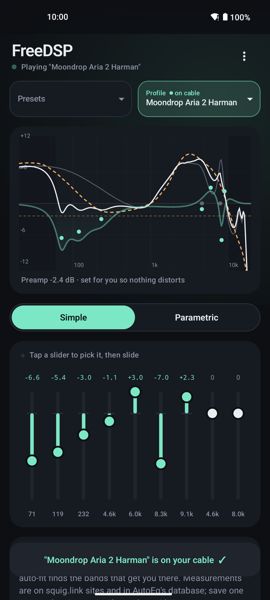
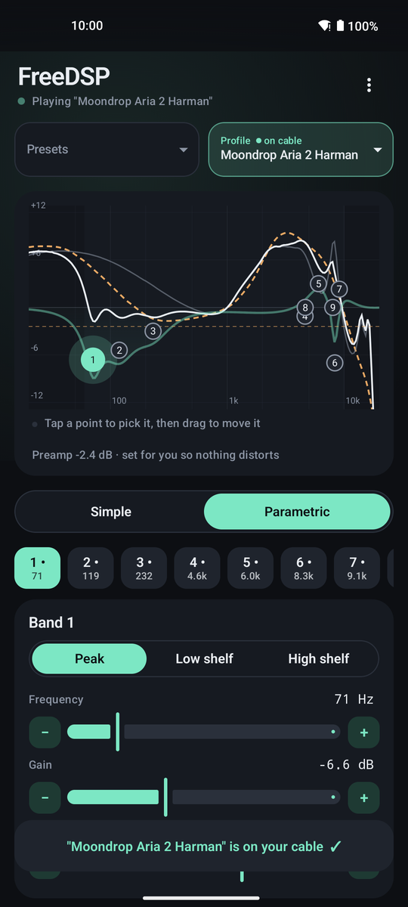
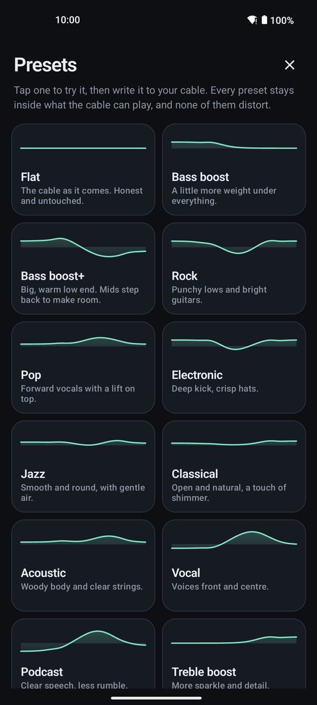
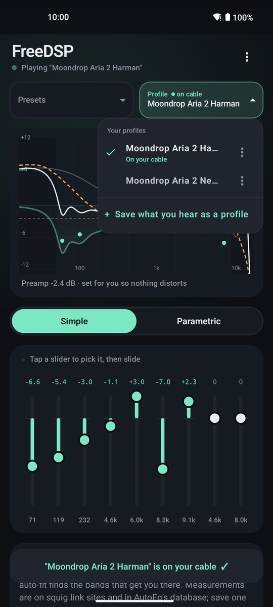
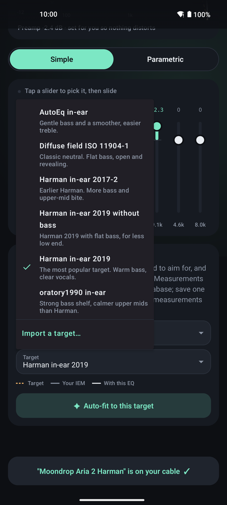

<h1 align="center">FreeDSP Android</h1>

<p align="center">
  Tune the Moondrop FreeDSP cable right from your phone.<br>
  Shape the sound, save it as profiles, auto-fit your IEMs to a target and write it to the cable.
</p>

<p align="center">
  <a href="https://github.com/Surya-SP/FreeDSP-Android/actions/workflows/build.yml"></a>
  
  
  
  
</p>

<p align="center">
  
  
  
  
  
</p>

---

The FreeDSP is a USB-C cable with a small DSP inside: it keeps a 9-band EQ in its own memory, so the sound follows the cable from phone to laptop. Moondrop's own app is the only way to change it on Android. FreeDSP Android is an open alternative: a clean editor that shows what you are doing, explains it in plain words, and checks every write by reading it back.

## Features

- **Two ways to edit.** *Simple* is a graphic EQ with nine sliders. *Parametric* lets you drag bands around the response graph and set frequency, gain, Q and filter type (peak, low shelf, high shelf) exactly.
- **No fighting the page.** Tap a slider or a point to pick it, then drag. While a band is picked, the page doesn't scroll; tap anywhere else to let go.
- **17 presets.** Bass boost, Rock, Vocal, Podcast, Hall, Late night and more, all designed inside the cable's range so none of them distort.
- **Profiles.** Save what you hear, rename, copy, delete, and export as text. A dot shows which one the cable is playing. Back up every profile to one file and restore it on a new phone or after a reinstall.
- **Match a target.** Import your IEM's measurement (squig.link or AutoEq text), pick a target such as Harman in-ear 2019 or diffuse field, and auto-fit finds the bands that get you there.
- **Import and export.** Paste or open AutoEQ / Equalizer APO parametric EQ text; export any profile the same way.
- **Safe by default.** The preamp is set automatically so the loudest point stays at 0 dB, and anything that could clip is refused before it reaches the cable.
- **Honest writes.** After writing, the app reads all nine bands back and only says "written" if they match exactly.

## Supported hardware

| | |
|---|---|
| **Cable** | Original Moondrop FreeDSP, USB ID `35D8:1496` |
| **Not supported** | FreeDSP Mini, FreeDSP Pro and other Moondrop DSP cables |
| **Phone** | Android 8.0 or newer with USB host (USB OTG) support |

Developed and used day to day on Android 15. Reports from other phones are very welcome.

## Download

Grab the latest `FreeDSP-Android-x.y.z.apk` from [Releases](https://github.com/Surya-SP/FreeDSP-Android/releases) and open it on your phone. Android will ask you to allow installs from your browser or file manager the first time.

Release APKs are signed with this certificate, so you can check you have the real thing:

```
SHA-256: 72:FF:4F:0D:27:DB:55:D2:66:5F:3F:30:89:2C:D3:47:7E:9C:EB:3A:43:AE:57:6C:85:21:88:39:DA:7B:1B:16
```

```sh
apksigner verify --print-certs FreeDSP-Android-0.6.0.apk
```

## Build it yourself

You don't need to trust a download: the whole app builds from this repo in a few minutes.

### With Android Studio (easiest)

1. Install [Android Studio](https://developer.android.com/studio) (Ladybug or newer).
2. **File › Open** and pick the `FreeDSP-Android` folder. Let Gradle sync; if it asks to install NDK `27.0.12077973` or CMake `3.22.1`, say yes.
3. On your phone, turn on **Developer options › USB debugging** (or Wireless debugging) and connect it.
4. Pick your phone in the device menu and press **Run**.

### From the command line

You need JDK 17 and the Android SDK with platform 35, build-tools, NDK `27.0.12077973` and CMake `3.22.1`:

```sh
sdkmanager "platforms;android-35" "build-tools;35.0.0" "ndk;27.0.12077973" "cmake;3.22.1"
```

Then:

```sh
git clone https://github.com/Surya-SP/FreeDSP-Android.git
cd FreeDSP-Android
./gradlew assembleDebug
adb install -r app/build/outputs/apk/debug/app-debug.apk
```

No `adb`? Copy `app-debug.apk` to your phone and open it there.

### Your own release build (optional)

A release build is smaller and faster than a debug one. Make a key once, keep it safe, and point the build at it:

```sh
keytool -genkeypair -keystore ~/freedsp-release.keystore -alias freedsp -keyalg RSA -keysize 4096 -validity 10000

export FREEDSP_RELEASE_KEYSTORE=~/freedsp-release.keystore
export FREEDSP_RELEASE_ALIAS=freedsp
export FREEDSP_RELEASE_PASSWORD='the password you chose'
./gradlew assembleRelease          # app/build/outputs/apk/release/app-release.apk
```

Without those variables `assembleRelease` still works but gives an unsigned APK. Android only installs an update over an app signed with the same key, so if you switch between your build and the official one, uninstall first. Use **⋮ › Back up all profiles** before you do, and **Restore profiles from a backup** afterwards.

## Using it

1. Plug the cable into your phone and open the app. Allow USB access when Android asks.
2. Pick a preset, or move the sliders until it sounds right.
3. Tap **Write**. Writing takes a couple of seconds; the cable restarts once to keep the EQ, and its inline buttons pause for that moment.
4. Like it? Open **Profile** and choose **Save what you hear as a profile**.

### Auto-fit to a target

1. Find your IEM on a squig.link site or in the [AutoEq database](https://github.com/jaakkopasanen/AutoEq/tree/master/results) and save its frequency response as a text file.
2. In **Match a target**, import it under **Your IEM** and pick a **Target**.
3. Choose where the fit stops (**Fit up to** 6, 8 or 10 kHz), then tap **Auto-fit to this target**. You get a profile called "*your IEM* fit" and a note saying how far from the target it was before and after.

Measurements of the top octave differ a lot between rigs and ears. That's why the fit stops at 8 kHz by default; above that, trust your ears.

## How it talks to the cable

The FreeDSP shows up as a USB audio device plus a HID interface for its buttons and settings. To read or write the EQ, the app briefly takes the HID interface (interface 3) from the system, sends its commands, and hands it straight back so the buttons work again. Audio is never touched.

- Every command is built from a fixed, typed set of frames. There is no raw command path and no firmware access.
- Writes stay inside the range the cable actually plays: 60 Hz to 10 kHz, -12 to +3 dB per band.
- The cable stores band gains in whole dB for display, so a value like 2.4 dB is kept exactly in your profile and in the filter itself, but appears rounded if you read the cable elsewhere.
- If Android ever kills the app in the middle of a session, the buttons may stay unresponsive. The app notices on its next start and offers to restore them; unplugging and replugging the cable fixes it too.

## Privacy

No internet permission, no analytics, no accounts and no microphone. Profiles, imported curves and settings stay in the app's private storage. Files only come in or go out through the system file picker or the clipboard.

## Running the tests

```sh
./gradlew testDebugUnitTest lintDebug assembleDebug
native-tests/run.sh        # checks the native USB helper on your computer, no cable needed
```

Unit tests cover the frame format, filter coefficients, read-back checks, the USB takeover logic, presets, text import and export, and auto-fit.

## Credits

- [FreeDSP-Studio](https://github.com/EffectiveEquivalent/FreeDSP-Studio) by EffectiveEquivalent (MIT): the desktop app whose protocol work and auto-fit this app builds on.
- [AutoEq](https://github.com/jaakkopasanen/AutoEq) by Jaakko Pasanen (MIT): the bundled target curves and the fitting approach.

Full notices are in [THIRD_PARTY_NOTICES.md](THIRD_PARTY_NOTICES.md) and inside the app.

## Disclaimer

This is an independent project. It is not made, endorsed or supported by Moondrop. Writing to the cable replaces the EQ stored on it; use the app at your own risk.

## License

[MIT](LICENSE) © 2026 Surya Prakash
